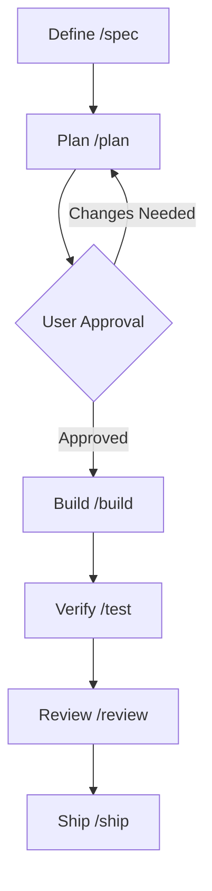

# CLAUDE.md — Agent Constitution & Project Guide

Welcome. This document defines the engineering guidelines, command reference, and workflows for agents (Claude, Cursor, Gemini) operating on this repository.

---

## 🚀 Quick Command Reference

Use these exact commands for common development operations. Do not hallucinate or guess.

### 🧪 Running Tests
- **Backend**: `npm run test:backend` (Jest; from the repo root)
- **Frontend**: `npm run test:frontend` (Vitest; from the repo root)
- **Both**: `npm test`
- **E2E**: `npm run test:e2e` (Playwright)

### 🧹 Linting & Formatting
- **Frontend lint**: `npm run lint:frontend` (max 20 warnings)
- **Backend lint**: `cd ag-extension-dashboard/src/backend && npm run lint`
- **Component-size ratchet**: `npm run check:component-size`

### ⚙️ Running Locally (Development)
- **Full stack**: `docker compose up -d` (from `ag-extension-dashboard/`)
- **Backend dev server**: `cd ag-extension-dashboard/src/backend && npm run dev`
- **Frontend dev server**: `cd ag-extension-dashboard/src/frontend && npm run dev`

---

## 🧭 Mandatory Engineering Workflow

You MUST execute all development tasks in the following sequential phases. Do not bypass or consolidate these phases.

1.  **Define (`/spec`)**: Analyze requirements, clarify ambiguities, identify impacted systems, and define constraints.
2.  **Plan (`/plan`)**: Author an `implementation_plan.md` outlining exact files to create/modify, verification plans, and open questions. **You must pause and obtain user approval here.**
3.  **Build (`/build`)**: Write clean, modular code. Write unit tests *before* or *alongside* implementation. Never write production code first and assume tests can wait.
4.  **Verify (`/test`)**: Run unit, integration, and linter suites. Address all errors and warnings before proceeding.
5.  **Review (`/review`)**: Perform a self-review of the diff, verify accessibility guidelines, check input sanitization, and audit console logs.
6.  **Ship (`/ship`)**: Formulate a concise change walkthrough and run final deployment validations.

---

## 🌿 Branching & Git Flow

To maintain Git hygiene and repository integrity, you MUST follow this branching model:
1. **Local Development**: All development and implementations must be done on the local `stage` branch.
2. **Local Merging**: When implementations are complete and verified, merge the local `stage` branch into the local `master` branch.
3. **Remote Syncing**: Push changes ONLY to the remote `stage` branch on GitHub (`git push origin stage`). Do not push directly to remote `master`.

---

## 🎨 Design & Coding Rules

- **No Placeholders**: Never use `TODO`, `FIXME`, or draft elements in code. Implement completed logic, fallback states, and complete error-handling patterns.
- **Decompose Components**: Avoid monolithic components. If a component exceeds 300 lines or contains independent sub-features, decompose it into smaller files and extract custom hooks.
- **Strict Error Handling**: Never use empty catch blocks. Always log errors properly on the backend or display friendly toasts/UI fallbacks on the frontend.
- **Security Gates**: Sanitise raw user inputs before rendering. Keep all secrets and configurations in environment variables.
- **TypeScript/Type Strictness**: Define proper types and interfaces for all models and payloads. Avoid `any` or lazy casting.
- **Unslop Design Standard (Quiet Chrome, Rich Content)**: Strictly adhere to the [Unslop](.agents/skills/unslop/SKILL.md) principles across all UI components and prose:
  - *Quiet Chrome*: Neutral surfaces (`slate`/`graphite`) with crisp 6–10% opacity hairline borders. No neon/purple gradients, radial color glow blobs behind cards, or gradient text. Depth comes from surface steps, not dramatic colored shadows.
  - *Rich Domain Content*: Richness belongs strictly to the agronomic content (satellite heatmaps, soil moisture layers, yield charts, outbreak clusters), never the decorative chrome.
  - *Typography & Scale*: Strict 4px spacing scale. Use sentence case for all titles, buttons, and navigation (no all-caps tracked labels). Limit to two font weights (400 and 500; 600 reserved for rare emphasis). Use tabular mono figures for agronomic metrics, hectares, and percentages.
  - *Icons & Signifiers*: Single line icon set (Lucide) at 16–18px / 1.5 stroke. No decorative emoji icons, emoji badges, or generic `✨ Sparkle` badges on AI features.
  - *Direct Agronomic Copy*: Zero AI hype words (*"supercharge", "revolutionary", "seamless magic", "game-changing"*). Use concrete, verifiable agronomic statements and explicit comparative metrics (`+14% yield vs prior season`).
- **No Code Deduplication**: Rigorously enforce the DRY (Don't Repeat Yourself) principle. Extract duplicate code block sequences, components, and configuration helpers into shared modules.
- **Diagnostics & Tooling**: Run local auditing tools such as `gsd` and `fallow` to trace unused code, dependencies, and verify project health. Always read and verify against the diagnostic guides inside `.claude/skills/` before altering subsystems.

---

## 🐳 Docker & CI/CD Deployment Rules

- **Container Recreation Safety**: Always run `docker compose down --remove-orphans` before restarting services on the target server. This prevents naming conflicts from orphaned containers.
- **Buildx Token Refresher**: Persistent Buildx builders (`remote-builder`, `stage-builder`) must be removed (`docker buildx rm <name> 2>/dev/null || true`) before being recreated to force-reload fresh, unexpired `GITHUB_TOKEN` credentials from the current run.
- **Local Caching (Bake)**: To bypass GHCR registry authorization rate limits and permission issues during workflow builds, direct cache exports (`cache-to`) to a local host directory (e.g., `type=local,dest=/root/docker-cache/<target>`) instead of remote registry endpoints. Ensure `--allow=fs="$HOME"` is passed to the bake execution (the deploy user's home, `/root` when deploying as root; `DOCKER_CACHE_DIR` points bake at `$HOME/docker-cache`).
- **External Shared Networks**: Any shared compose networks (e.g. `ag-network`) should be configured as `external: true` in `docker-compose.yml` to prevent compose label mismatch errors (`com.docker.compose.network`). The deployment pipelines must check/pre-create these networks (`docker network inspect ag-network >/dev/null 2>&1 || docker network create --driver bridge ag-network`, so real failures stay visible) before compose commands are run.
- **Container-Independent Probes (Smoke Gates)**: When probing running container status during pre-build smoke testing, use Node's native `fetch` API (e.g., `node -e "fetch(...)"`) instead of relying on external utilities like `curl` which may be absent in minimal production/slim container base images.
- **`.env` Owns the Database Password**: `DATABASE_PASSWORD` in the server's `.env` is the single source of truth (required in production). Postgres keeps the password a volume was created with, even when its container is recreated, so the production deploy aligns the role to `.env` on every run (local socket, no old password needed). To rotate: change `.env`, then deploy. Never set it by hand only in the database. Note that the official image trusts `127.0.0.1`, so a loopback login proves nothing about the password.
- **Failed Migrations Are Never Auto-Resolved**: Never run `npx prisma migrate resolve --applied` automatically or merely to unblock a deploy — it records SQL as applied that may never have run, leaving the database silently behind the schema (the docker entrypoint and deploy workflows fail fast for this reason). A `relation already exists` collision means the migration chain and the database disagree: stop, then either repair the migration/database and re-run `prisma migrate deploy`, or — only after a human has verified that every change in that migration already exists — record it as applied (see `docs/CICD_QA_PLAYLIST.md` Q34).
